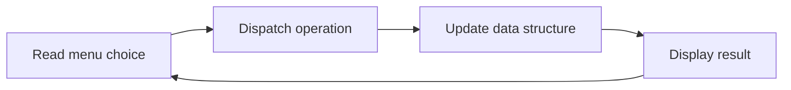

# Data Structures in C


A collection of fundamental data structure implementations written in C, covering stacks, queues, linked lists, binary search trees, dynamic arrays, and stack-based expression processing.

## Overview

The repository contains ten independent programs, each in its own directory with its source file and a dedicated `readme.md`. The programs demonstrate manual memory management, pointer manipulation, and the core operations of each structure through interactive menus or self-running demonstrations.

## Key Features

- Array-based and pointer-based implementations of linear data structures
- Binary search tree insertion, search, deletion, and three traversal orders
- Infix to postfix conversion with operator precedence and parentheses
- Postfix evaluation with checks for invalid characters, missing operands, and division by zero
- Dynamic memory management using `malloc`, `realloc`, and `free`
- Overflow and underflow handling for stacks and queues

## Programs

| Directory | Source File | Implementation | Operations | Interface |
| --- | --- | --- | --- | --- |
| [`StackOperations`](StackOperations) | `stack_operations.c` | Array-based stack | Push, pop, display, palindrome check | Menu |
| [`ExpressionConversion`](ExpressionConversion) | `infix_to_postfix.c` | Character stack | Infix to postfix conversion | Prompt |
| [`PostfixEvaluation`](PostfixEvaluation) | `postfix_evaluation.c` | Integer stack | Postfix expression evaluation | Self-running |
| [`CircularQueue`](CircularQueue) | `circular_queue.c` | Array-based circular queue | Insert, delete, display | Self-running |
| [`SinglyLinkedList`](SinglyLinkedList) | `singly_linked_list.c` | Singly linked list of student records | Insert and delete at both ends, display, stack and queue demonstrations | Menu |
| [`DoublyLinkedList`](DoublyLinkedList) | `doubly_linked_list.c` | Doubly linked list of employee records | Insert at front, after a key, and at end; delete at end; display with count | Menu |
| [`ListOperations`](ListOperations) | `list_operations.c` | Singly linked list of integers | Concatenate, sort, reverse | Prompt |
| [`BinarySearchTree`](BinarySearchTree) | `binary_search_tree.c` | Pointer-based binary search tree | Insert, traverse, search, delete | Menu |
| [`RollNumberManagement`](RollNumberManagement) | `roll_number_management.c` | Array of structures | Read student records, filter scores above 85 percent | Prompt |
| [`StudentDetailsProblem`](StudentDetailsProblem) | `student_details_problem.c` | Dynamically resized array | Insert and delete roll numbers by position, display | Menu |

## Technology Stack

| Component | Technology |
| --- | --- |
| Language | C |
| Compiler | GCC (any standard C compiler should work) |
| Libraries | C standard library (`stdio.h`, `stdlib.h`, `string.h`, `ctype.h`) |
| Interface | Terminal (standard input and output) |

## Architecture and Workflow

Every program is independent and has no shared headers or build dependencies. Interactive programs repeat a read, dispatch, and display cycle until the user exits.



## Project Structure

```text
DataStructuresInC/
├── BinarySearchTree/
│   ├── binary_search_tree.c
│   └── readme.md
├── CircularQueue/
│   ├── circular_queue.c
│   └── readme.md
├── DoublyLinkedList/
│   ├── doubly_linked_list.c
│   └── readme.md
├── ExpressionConversion/
│   ├── infix_to_postfix.c
│   └── readme.md
├── ListOperations/
│   ├── list_operations.c
│   └── readme.md
├── PostfixEvaluation/
│   ├── postfix_evaluation.c
│   └── readme.md
├── RollNumberManagement/
│   ├── roll_number_management.c
│   └── readme.md
├── SinglyLinkedList/
│   ├── singly_linked_list.c
│   └── readme.md
├── StackOperations/
│   ├── stack_operations.c
│   └── readme.md
├── StudentDetailsProblem/
│   ├── student_details_problem.c
│   └── readme.md
└── README.md
```

## Installation and Setup

### Prerequisites

- GCC or another C compiler

### Clone the Repository

```bash
git clone https://github.com/Partha-Shankar/DataStructuresInC.git
cd DataStructuresInC
```

### Compile a Program

```bash
cd BinarySearchTree
gcc binary_search_tree.c -o binary_search_tree
```

## Usage

Run the compiled binary from the same directory.

```bash
./binary_search_tree          # Linux and macOS
.\binary_search_tree.exe      # Windows
```

### Example: Binary Search Tree

Inserting 50, 30, 70, 20, and 40 and then selecting the traverse option produces:

```text
Inorder traversal:
20	30	40	50	70
Preorder traversal:
50	30	20	40	70
Postorder traversal:
20	40	30	70	50
```

Deleting key 30 and traversing again produces:

```text
Inorder traversal:
20	40	50	70
Preorder traversal:
50	40	20	70
Postorder traversal:
20	40	70	50
```

### Example: List Operations

Entering `3 1 4` for the first list and `5 2` for the second produces the output below. Each element is inserted at the head of its list, so each list holds its values in reverse input order.

```text
Concatenated list:
4 1 3 2 5
Sorted list:
1 2 3 4 5
Reversed list:
5 4 3 2 1
```

### Example: Infix to Postfix Conversion

```text
Enter infix expression: A+(B*C)

Postfix expression: ABC*+
```

## Technical Implementation

### Stack Operations

A fixed array of four elements with a top-of-stack index. The palindrome check pushes the digits of a number and compares them as they are popped.

### Expression Processing

Infix conversion uses an operator stack with a sentinel value and a precedence function supporting `+`, `-`, `*`, `/`, `%`, and `^`. Postfix evaluation handles single-digit operands and the operators `+`, `-`, `*`, and `/`. The expression is defined in `main()`, and the included expression `656+5*2*` leaves two values on the stack, which demonstrates the malformed-expression check. A well-formed expression such as `56+2*` evaluates to 22.

### Circular Queue

Front and rear indices wrap around with modular arithmetic. The program inserts the seven characters of `VIBGOYR` into a queue of capacity seven, then performs two deletions, displaying the queue after each step.

### Linked Lists

Nodes are allocated individually on the heap. The singly linked list also demonstrates stack behavior (insert and delete at the front) and queue behavior (insert at the end and delete at the front). The doubly linked list maintains head and tail pointers, which makes insertion and deletion at the end constant-time, and releases all nodes on exit.

### Binary Search Tree

Insertion and search are iterative, traversals are recursive, and deletion handles nodes with zero, one, or two children, using the inorder successor in the two-child case. Duplicate values are placed in the right subtree.

### Dynamic Array

`StudentDetailsProblem` resizes its array with `realloc` on every insertion and deletion, shifting elements to preserve order.

## Scope and Assumptions

- `StackOperations` has a capacity of four elements, so its palindrome check applies to numbers of up to four digits.
- `ExpressionConversion` accepts single-character operands and expressions of up to 18 characters.
- `PostfixEvaluation` accepts single-digit operands and uses integer arithmetic.
- `ListOperations` expects at least one element in the first list.
- `RollNumberManagement` handles up to five student records.
